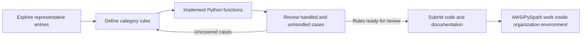
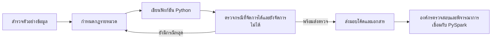

# Data Quality Improvement Project

## Purpose and contribution

The project developed category-specific quality rules from exploratory review of representative entries. I analyzed the approved categories, translated observed data issues into Python transformations and checks, reviewed edge cases, and submitted the functions for organizational review.

## Workflow

## Category pages

- [Education](education/README.md)
- [Email format](email/README.md)
- [Gender](gender/README.md)
- [Income](income/README.md)
- [Marital status](marital-status/README.md)
- [Occupation](occupation/README.md)
- [Workflow and handoff notes](documentation/README.md)
- [Synthetic Python demonstration](examples/synthetic_quality_rules.py)

## Technical approach

The submitted Python work used Pandas, regular expressions, and mapping logic to standardize values and validate category-specific formats. The work was reviewed by category so that uncovered cases could be added to the rules. The code in this public folder is a separate, simplified demonstration; it is not the submitted implementation.

## Results and status

The deliverable was a set of Python functions and supporting notes for the organization to review. Work also involved an AWS/PySpark stage inside the organization environment. The organization’s final validation/adoption status is not confirmed here, so this page does not claim production deployment, a measured quality increase, or a processing speedup. No source code or infrastructure details are published.

## Privacy

Only the six approved category names are represented. All demonstration values are generated for this portfolio. Source records, notebook outputs, real email addresses, names, government identifiers, and categories that were not cleared for public use are excluded.

---

## ภาษาไทย

# Data Quality Improvement Project

## เป้าหมายและส่วนที่รับผิดชอบ

โครงการนี้สร้างกฎคุณภาพข้อมูลแยกตามหมวดจากการสำรวจตัวอย่างข้อมูล ฉันวิเคราะห์หมวดที่เปิดเผยได้ แปลงปัญหาที่พบให้เป็นขั้นตอนแปลงและตรวจสอบด้วย Python ทบทวนกรณียกเว้น แล้วส่งมอบฟังก์ชันให้องค์กรตรวจสอบ

## ขั้นตอนการทำงาน

## หน้ารายหมวด

- [Education](education/README.md)
- [รูปแบบ Email](email/README.md)
- [Gender](gender/README.md)
- [Income](income/README.md)
- [Marital status](marital-status/README.md)
- [Occupation](occupation/README.md)
- [ขั้นตอนและการส่งมอบ](documentation/README.md)
- [ตัวอย่าง Python ด้วยข้อมูลสังเคราะห์](examples/synthetic_quality_rules.py)

## วิธีการทางเทคนิค

โค้ด Python ที่ส่งมอบใช้ Pandas, regular expressions และ mapping logic เพื่อปรับรูปแบบและตรวจค่าเฉพาะแต่ละหมวด มีการทบทวนแยกตามหมวด แล้วเพิ่มกรณีที่ยังจัดการไม่ได้เข้าไปในกฎ โค้ดในโฟลเดอร์สาธารณะนี้เป็นตัวอย่างที่เขียนใหม่และลดทอนรายละเอียด ไม่ใช่ implementation ที่ส่งมอบจริง

## ผลลัพธ์และสถานะ

ส่งมอบฟังก์ชัน Python และบันทึกประกอบให้องค์กรตรวจสอบ งานมีขั้นตอน AWS/PySpark ภายในสภาพแวดล้อมขององค์กร แต่ยังไม่ยืนยันสถานะการตรวจสอบและการนำไปใช้ขั้นสุดท้าย จึงไม่กล่าวอ้างว่าขึ้น production แล้ว ไม่ระบุเปอร์เซ็นต์คุณภาพที่เพิ่มขึ้นหรือความเร็วที่ดีขึ้น และไม่เผยแพร่ source code หรือรายละเอียดระบบ

## ความเป็นส่วนตัว

แสดงเฉพาะชื่อหกหมวดที่ได้รับอนุญาต ค่าตัวอย่างทั้งหมดสร้างขึ้นใหม่สำหรับ Portfolio ไม่ใส่แถวข้อมูลจริง ผลลัพธ์ Notebook อีเมลจริง ชื่อ เลขประจำตัว หรือหมวดที่ยังไม่ได้รับอนุญาตให้เผยแพร่
