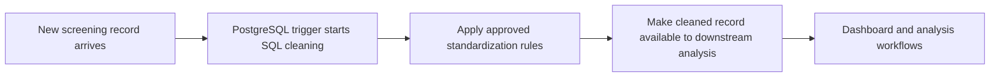
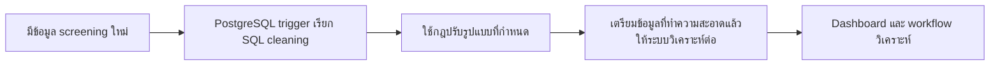

# Screening Data Cleaning + PostgreSQL Trigger

## Purpose

Automate cleaning for newly received screening data using SQL in Supabase PostgreSQL. The work covers personal and demographic fields, body-measurement and location fields, and clinical screening-assessment data. The public page describes the workflow without publishing the production schema or exact rules.

## Workflow

## Public-safe demonstration

- [Generic PostgreSQL trigger example](examples/generic_text_cleaning_trigger.sql)

The SQL file demonstrates a simple text-normalization trigger on a fictional table. It is newly written for this portfolio and is not the organization’s production code, table design, or medical-data cleaning logic.

## Outcome

Incoming records were handled through an automatic database-triggered cleaning workflow rather than relying only on a separate manual step. No claim is made about an error reduction, latency, or data-volume metric because no approved measurement is included here.

## Privacy boundary

No production SQL, actual column names, row-level values, screenshots, credentials, database URL, or Supabase project configuration is included.

---

## ภาษาไทย

# การทำความสะอาดข้อมูล Screening + PostgreSQL Trigger

## เป้าหมาย

ทำความสะอาดข้อมูล screening ที่เข้ามาใหม่โดยอัตโนมัติด้วย SQL บน Supabase PostgreSQL งานครอบคลุมข้อมูลส่วนบุคคลและประชากรศาสตร์ ข้อมูลสัดส่วนร่างกายและพื้นที่ รวมถึงข้อมูลแบบประเมินทางคลินิก หน้า Portfolio จะอธิบาย workflow โดยไม่เปิดเผย schema หรือกฎ production จริง

## Workflow

## ตัวอย่างที่เผยแพร่ได้

- [ตัวอย่าง PostgreSQL trigger ทั่วไป](examples/generic_text_cleaning_trigger.sql)

ไฟล์ SQL เป็นตัวอย่างการปรับข้อความในตารางสมมติ เขียนขึ้นใหม่เพื่อ Portfolio ไม่ใช่โค้ด production โครงสร้างตาราง หรือกฎทำความสะอาดข้อมูลทางการแพทย์ขององค์กร

## ผลลัพธ์

ข้อมูลใหม่ถูกจัดการผ่าน workflow ทำความสะอาดอัตโนมัติที่เริ่มจาก database trigger ไม่ได้พึ่งเฉพาะขั้นตอน manual แยกต่างหาก ไม่มีการกล่าวอ้างจำนวนข้อผิดพลาดที่ลดลง latency หรือปริมาณข้อมูล เพราะไม่มีตัวเลขที่อนุมัติให้เผยแพร่

## ขอบเขตความเป็นส่วนตัว

ไม่มี SQL production ชื่อคอลัมน์จริง ค่าในแต่ละแถว ภาพหน้าจอ credentials, database URL หรือการตั้งค่า Supabase ของโครงการ
