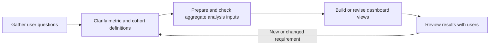
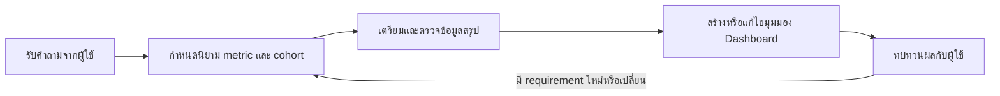

# CheckPD Dashboard — Requirements to Analysis

## My role

I gathered and clarified what users needed to understand, then created and revised dashboard views to answer those questions. The production dashboard is not shown: it contains organization data and is not cleared for public display.

## Questions translated into dashboard analysis

### 1. App reach and usage over time

- How many people used CheckPD?
- How did usage change across provinces?
- During which periods was app usage highest?

### 2. Screening completion and drop-off

- How many users completed all assessments, completed some, or did not complete them?
- Among partial completions, which assessments were most and least often completed?
- What barriers were reported or observed, such as health limitations, difficult tasks, or confusing app steps?

### 3. Comparison after app updates

- Compare completion and non-completion patterns before and after updates.
- Report changes only when the periods, cohorts, and definitions are comparable and the underlying aggregate result is approved for sharing.

### 4. Screening-risk result comparison

Summarize screening-risk classifications against the relevant clinical assessment in a confusion-matrix structure: true positives, false positives, true negatives, and false negatives. CheckPD is described as a screening tool; dashboard results are not presented as a diagnosis.

### 5. Assessment patterns by group

Compare aggregate patterns across Parkinson’s disease, prodromal, and healthy groups for screening assessments such as Rome IV, HAMD, and RBD. The analysis helps teams review patterns and possible differences; it does not expose individual assessment answers or make claims beyond the analysis.

## Workflow

## Result and evidence

The deliverable was a dashboard revised around users’ analysis questions, including app uptake, completion, drop-off, post-update comparisons, screening-risk results, and assessment patterns. The real dashboard, internal values, screenshots, and unapproved operational metrics are intentionally not included. If a public visual is needed, it should be a separately created illustration with synthetic values, clearly labeled as a demo.

---

## ภาษาไทย

# CheckPD Dashboard — จาก Requirement สู่การวิเคราะห์

## ส่วนที่รับผิดชอบ

ฉันรับและทำความเข้าใจสิ่งที่ผู้ใช้ต้องการรู้ แล้วสร้างและแก้ไขมุมมองใน Dashboard ให้ตอบคำถามเหล่านั้น โดยไม่แสดง Dashboard production เพราะมีข้อมูลองค์กรและยังไม่ได้รับอนุญาตให้นำขึ้นสาธารณะ

## คำถามที่นำมาวิเคราะห์บน Dashboard

### 1. การเข้าถึงและช่วงเวลาการใช้งานแอป

- มีผู้ใช้ CheckPD จำนวนเท่าใด
- จำนวนการใช้งานเปลี่ยนไปอย่างไรในแต่ละจังหวัด
- ช่วงเวลาใดมีการใช้งานแอปสูงที่สุด

### 2. การทำ screening ครบและจุดที่หยุดทำ

- มีผู้ทำแบบประเมินครบ ทำบางส่วน หรือทำไม่ครบจำนวนเท่าใด
- ในกลุ่มที่ทำบางส่วน แบบประเมินใดมีผู้ทำมากและน้อยที่สุด
- มีอุปสรรคอะไรบ้าง เช่น ข้อจำกัดด้านสุขภาพ แบบทดสอบยาก หรือขั้นตอนในแอปไม่ชัดเจน

### 3. การเปรียบเทียบหลังปรับแอป

- เปรียบเทียบรูปแบบการทำครบและไม่ครบก่อนกับหลังการปรับปรุง
- รายงานการเปลี่ยนแปลงเมื่อช่วงเวลา กลุ่มที่นำมาเปรียบเทียบ และนิยามตัวชี้วัดเทียบกันได้ และได้รับอนุญาตให้เผยแพร่ผลรวมแล้วเท่านั้น

### 4. การเปรียบเทียบผลการคัดกรองความเสี่ยง

สรุปผลการจัดกลุ่มความเสี่ยงเทียบกับผลประเมินทางคลินิกที่เกี่ยวข้องในรูปแบบ confusion matrix ได้แก่ true positive, false positive, true negative และ false negative โดยอธิบาย CheckPD ว่าเป็นเครื่องมือคัดกรอง ไม่ใช่เครื่องมือวินิจฉัยโรค

### 5. รูปแบบผลการประเมินแยกตามกลุ่ม

เปรียบเทียบรูปแบบผลรวมระหว่างกลุ่ม Parkinson’s disease, prodromal และ healthy จากแบบประเมิน เช่น Rome IV, HAMD และ RBD เพื่อให้ทีมเห็นแนวโน้มหรือความแตกต่างที่ควรพิจารณา โดยไม่เปิดเผยคำตอบรายบุคคลและไม่สรุปเกินกว่าผลวิเคราะห์รองรับ

## ขั้นตอนการทำงาน

## ผลลัพธ์และหลักฐาน

ส่งมอบ Dashboard ที่สร้างหรือปรับตามคำถามวิเคราะห์ของผู้ใช้ ครอบคลุมการใช้งานแอป การทำแบบประเมินครบ จุดที่หยุดทำ การเปรียบเทียบหลังปรับแอป ผลการคัดกรองความเสี่ยง และรูปแบบผลประเมิน จะไม่นำ Dashboard จริง ค่าภายใน ภาพหน้าจอ หรือตัวเลขปฏิบัติงานที่ยังไม่ได้อนุมัติมาใส่ หากต้องการภาพประกอบ ให้สร้างภาพใหม่ด้วยข้อมูลสังเคราะห์และติดป้ายชัดเจนว่าเป็น demo
