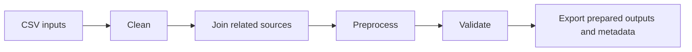

# Cleaning and Preprocessing

## Workflow design

The project organized data preparation as a sequence of focused stages:

### Clean

Normalize values and apply documented handling for missing, malformed, out-of-range, and duplicate entries.

### Join

Combine related sources using defined keys and check the join results.

### Preprocess

Prepare analysis subsets and derive required fields according to the agreed workflow.

### Validate

Check schemas, keys, data types, dates, ranges, duplicates, derived outputs, and summary counts.

### Export

Write prepared outputs and metadata for downstream use. The workflow tracks stage-level processing information; no performance improvement is claimed without a measured comparison.

The source implementation processes CSV rows incrementally and separates functionality into reusable modules. This repository contains no source data, original notebook outputs, or project-specific medical field schema.

## Demonstration code

The [synthetic pipeline example](../examples/synthetic_pipeline_demo.py) is a newly written, small demonstration. It is not the original project code or an exact reproduction of its domain rules.

---

## ภาษาไทย

# Cleaning and Preprocessing

## การออกแบบ workflow

โครงการแบ่งการเตรียมข้อมูลเป็นขั้นตอนที่มีหน้าที่ชัดเจน:

### Clean

ปรับรูปแบบค่าและใช้กฎที่กำหนดไว้กับข้อมูลที่หายไป ผิดรูปแบบ อยู่นอกช่วง และข้อมูลซ้ำ

### Join

เชื่อมแหล่งข้อมูลที่เกี่ยวข้องด้วยคีย์ที่กำหนด พร้อมตรวจผลการเชื่อม

### Preprocess

เตรียมชุดข้อมูลสำหรับการวิเคราะห์และสร้างฟิลด์ที่จำเป็นตาม workflow ที่กำหนด

### Validate

ตรวจ schema, key, ชนิดข้อมูล, วันที่, ช่วงค่า, ข้อมูลซ้ำ, ผลลัพธ์จากค่าที่คำนวณ และจำนวนสรุป

### Export

ส่งออกข้อมูลที่เตรียมแล้วพร้อม metadata สำหรับใช้งานต่อ workflow ต้นทางอ่านข้อมูล CSV เป็นส่วน ๆ และแยกฟังก์ชันเป็นโมดูลที่นำกลับมาใช้ได้ มีการเก็บข้อมูลระดับขั้นตอน แต่ไม่มีการกล่าวอ้างว่าประสิทธิภาพเพิ่มขึ้นหากไม่มีการเปรียบเทียบที่วัดจริง

Repository นี้ไม่มีข้อมูลต้นทาง ผลลัพธ์ Notebook เดิม หรือ schema ฟิลด์ทางการแพทย์ของโครงการ

## โค้ดสาธิต

[ตัวอย่าง pipeline ด้วยข้อมูลสังเคราะห์](../examples/synthetic_pipeline_demo.py) เขียนขึ้นใหม่เพื่อสาธิตแนวคิด ไม่ใช่โค้ดต้นฉบับหรือกฎเฉพาะของข้อมูลในโครงการ
